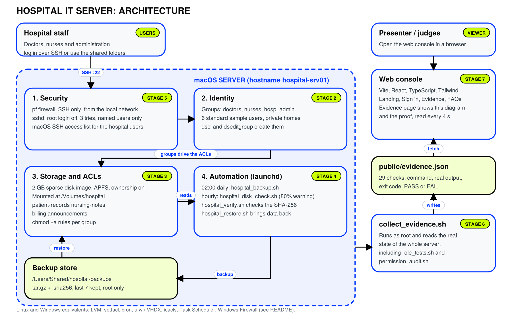
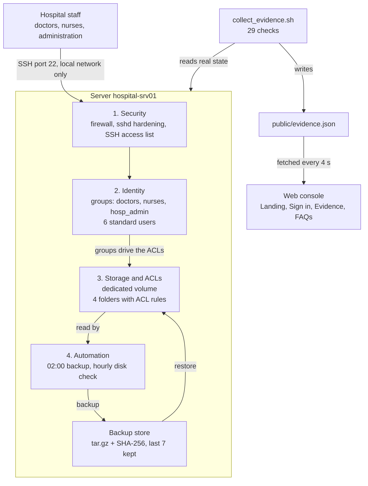
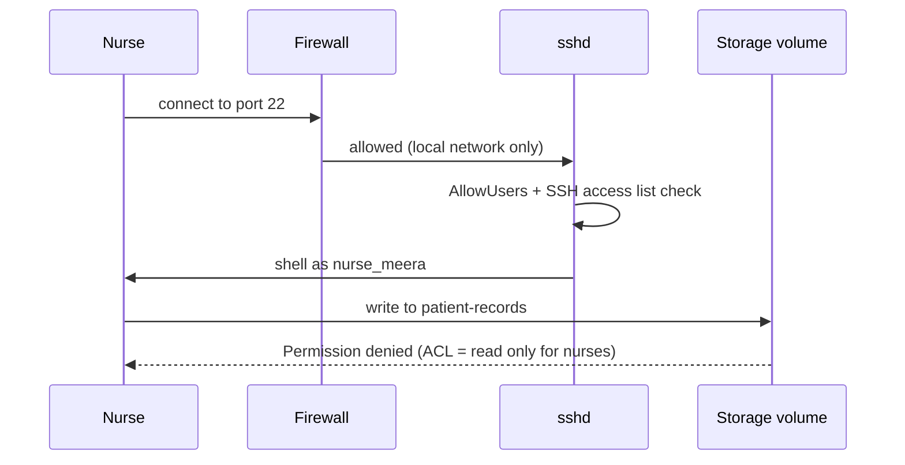
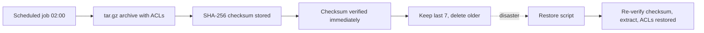

# 🏥 Hospital IT Server Console (OrangeCats)

> A complete, role-based hospital IT server build (users, storage, ACLs, backups, firewall, hardened SSH) plus a web console that displays **real terminal output** as evidence.



| | |
|---|---|
| **Team** | OrangeCats |
| **Scenario** | Hospital IT department (Problem Statement 2) |
| **Server hostname** | `hospital-srv01` |
| **Primary platform (tested)** | macOS (Apple Silicon / Intel) |
| **Equivalent platforms** | Linux (Ubuntu 22.04 / 24.04) and Windows 10/11 Pro commands provided per stage |
| **Web console** | Vite + React + TypeScript + Tailwind |

### 📄 Project Documents

| Document | Link |
|---|---|
| 📘 Project Report | [Project-Report.pdf](hs-report.pdf) |
| 🎞️ Presentation (PDF) | [Project-Presentation.pdf](hs-ppt.pdf) |
| 🎨 Presentation (Canva) | [View on Canva](https://canva.link/dn9qgcm42wbiu5z) |
| Repo Arc | [Repo Arch](./Orange-Cats.png) |

---

## 📑 Table of Contents

1. [Problem Statement](#1-problem-statement)
2. [Objectives](#2-objectives)
3. [Proposed Solution and Project Overview](#3-proposed-solution-and-project-overview)
4. [System Architecture / Workflow Diagram](#4-system-architecture--workflow-diagram)
5. [Tools, Technologies and Environment Used](#5-tools-technologies-and-environment-used)
6. [Linux Commands, Configurations and Scripts Implemented](#6-linux-commands-configurations-and-scripts-implemented)
7. [Storage Management / LVM / Backup and Recovery](#7-storage-management--lvm--backup-and-recovery)
8. [Automation and Shell Scripting](#8-automation-and-shell-scripting)
9. [Security and User/Permission Management](#9-security-and-userpermission-management)
10. [Implementation Screenshots and Live Demonstration](#10-implementation-screenshots-and-live-demonstration)
11. [Testing, Results and Observations](#11-testing-results-and-observations)
12. [Challenges Faced and Solutions](#12-challenges-faced-and-solutions)
13. [Conclusion and Future Enhancements](#13-conclusion-and-future-enhancements)
14. [References](#14-references)
15. [Appendix: Repository Layout, Setup and Undo](#15-appendix-repository-layout-setup-and-undo)

---

## 1. Problem Statement

A hospital IT department needs **one shared server** used by three very different groups of staff: **doctors, nurses and administration**. These groups handle sensitive data (patient records, nursing notes, billing) and must **not** be able to read or change each other's data. At the same time, the system must be reliable: data must survive accidental deletion or disk problems, and the server must resist unauthorised remote access.

Without a proper design, a hospital server typically suffers from:

- Shared or generic accounts, so nobody can be held accountable.
- Folders open to everyone, risking privacy breaches (for example, billing staff reading medical records).
- No scheduled backups, or backups that were never verified.
- Open network ports and default SSH settings that invite attacks.
- No evidence that the configuration actually works.

**The task:** design, build, secure, automate and test a multi-role server, and present proof of every step.

---

## 2. Objectives

1. **Configure the base system**: hostname, network check, updates and required packages.
2. **Administer users and groups**: three role groups and six standard (non-administrator) users with private home folders.
3. **Manage storage**: a dedicated, resizable volume with four shared folders.
4. **Enforce least-privilege access**: per-group ACLs so each role gets only the access its job needs.
5. **Automate operations**: scheduled daily backups, integrity verification and disk-space monitoring.
6. **Provide backup and recovery**: dated archives, SHA-256 checksums, and a tested restore script.
7. **Harden security**: firewall, hardened SSH, and a permission audit.
8. **Test and document**: role-matrix tests, a simulated failure with recovery, and a web console that shows real terminal output as evidence.

---

## 3. Proposed Solution and Project Overview

The project has two parts that work together.

### Part A: The server build (shell scripts + system tools)

A set of scripts builds the server **stage by stage**:

| Stage | Purpose |
|---|---|
| 1. Base setup | Hostname, network info, update check, packages |
| 2. Users and groups | 3 groups, 6 users, passwords, private homes |
| 3. Storage and ACLs | 2 GB volume, 4 shared folders, ACL rules per group |
| 4. Automation and backup | Daily backup at 02:00, hourly disk check, retention of last 7 backups |
| 5. Security | Firewall, SSH hardening, permission audit |
| 6. Testing and recovery | Role tests, delete-and-restore demo, storage-failure simulation |

### Part B: The web console (evidence dashboard)

A React single-page app (Landing, Sign in, **Evidence**, FAQs). A web page cannot run system commands, so the console **never executes anything**. Instead, `collect_evidence.sh` runs **29 read-only checks** on the real server and writes the command, real output, exit code and PASS/FAIL result into `public/evidence.json`. The Evidence page fetches this file every 4 seconds and shows a PASS/FAIL badge per stage.

### Who can access what

| Folder | doctors | nurses | hosp_admin |
|---|---|---|---|
| `patient-records` | read + write | read | none |
| `nursing-notes` | read | read + write | none |
| `billing` | none | none | read + write |
| `announcements` | read | read | read + write |

**Sample users:** `dr_asha`, `dr_ravi` (doctors) · `nurse_meera`, `nurse_john` (nurses) · `admin_priya`, `admin_kiran` (administration).

> **Why `hosp_admin` and not `admin`?** macOS already has a built-in `admin` group that grants full administrator rights. Reusing it would make hospital staff administrators of the whole machine. On Linux the group is named `admin`; on Windows, `hosp_admin`.

---

## 4. System Architecture / Workflow Diagram

The server has four dependent building blocks: **Security** decides who can connect, **Identity** decides who they are, **Storage** decides what each group can touch, and **Automation** protects the data.



### Access workflow: a nurse tries to write a patient record



### Backup and recovery workflow



---

## 5. Tools, Technologies and Environment Used

| Area | macOS (tested) | Linux equivalent | Windows equivalent |
|---|---|---|---|
| OS | macOS (Apple Silicon/Intel) | Ubuntu 22.04 / 24.04 | Windows 10/11 Pro |
| Accounts & groups | `dscl`, `dseditgroup` | `useradd`, `groupadd`, `getent` | `New-LocalUser`, `New-LocalGroup` |
| Storage | Sparse disk image (APFS), mounted at `/Volumes/hospital` | **LVM** on loop device (`pvcreate`, `vgcreate`, `lvcreate`, ext4) | VHDX via `diskpart` (NTFS) |
| Folder permissions | `chmod +a` ACLs | `setfacl` / `getfacl` | `icacls` |
| Scheduling | `launchd` | `cron` (`/etc/cron.d`) | Task Scheduler |
| Backup integrity | `tar`, `shasum` | `tar --acls`, `sha256sum` | `Compress-Archive`, `Get-FileHash` |
| Firewall | `pf` (own anchor) | `ufw` | Windows Firewall |
| Remote access | `sshd_config.d` drop-in | `sshd_config.d` drop-in | OpenSSH Server |
| Web console | Vite, React, TypeScript, Tailwind CSS, oxlint | same | same |

**Prerequisites:** about 3 GB free space, an administrator/sudo account, Node.js 20+ (for the console), Homebrew (macOS) or `apt` (Ubuntu).

> **Note on environment:** the full build was executed and verified on **macOS**, using macOS-native equivalents of the Linux tooling (disk image instead of LVM, `launchd` instead of cron, `pf` instead of `ufw`). The Linux and Windows command sets for each stage are included so the same design can be reproduced on those systems.

---

## 6. Linux Commands, Configurations and Scripts Implemented

### Stage 1: Base setup (Ubuntu)

```bash
sudo hostnamectl set-hostname hospital-srv01
ip -br addr
sudo apt update && sudo apt upgrade -y
sudo apt install -y acl lvm2 openssh-server ufw rsync
```

### Stage 2: Users and groups (Ubuntu)

```bash
sudo bash linux/create_users.sh
getent group doctors nurses admin
```

(macOS: `sudo bash src/scripts/mac/create_users.sh`, then verify with `dscl . -read /Groups/doctors GroupMembership` and `id nurse_meera`.)

### Stage 3: Storage and ACLs (Ubuntu)

See [Section 7](#7-storage-management--lvm--backup-and-recovery) for the full LVM and ACL command set.

### Stage 4: Automation (Ubuntu)

See [Section 8](#8-automation-and-shell-scripting).

### Stage 5: Security (Ubuntu)

See [Section 9](#9-security-and-userpermission-management).

### Script inventory

| Script | Stage | Function |
|---|---|---|
| `linux/create_users.sh` | 2 | Creates groups and users on Linux |
| `src/scripts/mac/create_users.sh` / `remove_users.sh` | 2 | Create / undo groups and users (macOS) |
| `src/scripts/mac/setup_storage.sh` / `teardown_storage.sh` | 3 | Create / undo disk image, folders and ACLs |
| `src/scripts/mac/install_automation.sh` | 4 | Installs scripts and schedules `launchd` jobs |
| `src/scripts/mac/hospital_backup.sh` | 4 | Backup with checksum and retention |
| `src/scripts/mac/hospital_verify.sh` | 4 | Integrity check of backups |
| `src/scripts/mac/hospital_disk_check.sh` | 4 | Warns at 80% disk usage |
| `src/scripts/mac/uninstall_automation.sh` | 4 | Removes scheduled jobs |
| `src/scripts/mac/firewall.sh` | 5 | `pf` firewall (`on`, `off`, `status`, `check`) |
| `src/scripts/mac/harden_ssh.sh` | 5 | SSH hardening (`apply`, `remove`) |
| `src/scripts/mac/permission_audit.sh` | 5 | Audit with PASS/FAIL output |
| `src/scripts/mac/hospital_restore.sh` | 6 | Verified restore from latest backup |
| `src/scripts/mac/role_tests.sh` | 6 | Role × folder access matrix test |
| `src/scripts/mac/collect_evidence.sh` | Evidence | 29 checks → `public/evidence.json` |

---

## 7. Storage Management / LVM / Backup and Recovery

### 7.1 Storage design

- A dedicated **2 GB volume** separate from the system disk, so it can be resized, unmounted and backed up on its own.
- On macOS this is a **sparse disk image** mounted at `/Volumes/hospital` with **ownership enabled** so permissions apply. It is the macOS stand-in for LVM.
- Four shared folders: `patient-records`, `nursing-notes`, `billing`, `announcements`.

### 7.2 LVM implementation (Linux / Ubuntu)

```bash
sudo truncate -s 2G /srv/hospital.img
LOOP=$(sudo losetup --find --show /srv/hospital.img)
sudo pvcreate "$LOOP"
sudo vgcreate hospital_vg "$LOOP"
sudo lvcreate -n data -l 100%FREE hospital_vg
sudo mkfs.ext4 /dev/hospital_vg/data
sudo mkdir -p /hospital
sudo mount /dev/hospital_vg/data /hospital
sudo mkdir -p /hospital/{patient-records,nursing-notes,billing,announcements}
sudo chmod 700 /hospital/{patient-records,nursing-notes,billing,announcements}
```

**Extending the volume later:**

```bash
# grow the image file, then:
sudo lvextend -r -L +1G /dev/hospital_vg/data
```

> A loop-backed volume must be re-attached after a reboot (`losetup`, `vgchange -ay`, `mount`).

### 7.3 ACL configuration (Linux)

The `-d` entries are default ACLs so new files inherit the rules.

```bash
# patient-records: doctors rw, nurses read
sudo setfacl -m g:doctors:rwx,g:nurses:r-x /hospital/patient-records
sudo setfacl -d -m g:doctors:rwx,g:nurses:r-x /hospital/patient-records

# nursing-notes: nurses rw, doctors read
sudo setfacl -m g:doctors:r-x,g:nurses:rwx /hospital/nursing-notes
sudo setfacl -d -m g:doctors:r-x,g:nurses:rwx /hospital/nursing-notes

# billing: administration only
sudo setfacl -m g:admin:rwx /hospital/billing
sudo setfacl -d -m g:admin:rwx /hospital/billing

# announcements: everyone reads, administration writes
sudo setfacl -m g:doctors:r-x,g:nurses:r-x,g:admin:rwx /hospital/announcements
sudo setfacl -d -m g:doctors:r-x,g:nurses:r-x,g:admin:rwx /hospital/announcements

getfacl /hospital/patient-records
```

### 7.4 Backup strategy

| Property | Value |
|---|---|
| Schedule | Daily at **02:00** |
| Format | Dated `tar.gz` archive (ACLs preserved) |
| Integrity | **SHA-256** checksum stored and verified right after creation |
| Retention | Last **7** archives kept, older deleted |
| Location | Outside the data volume (`/Users/Shared/hospital-backups` on macOS, `/var/backups/hospital` on Linux) |

### 7.5 Recovery procedure

```bash
# Simulate disaster
sudo rm -rf /hospital/patient-records

# Restore from the latest verified backup (Linux)
sudo tar --acls -xzf "$(ls -1t /var/backups/hospital/hospital-data-*.tar.gz | head -n 1)" -C /hospital
getfacl /hospital/patient-records
```

On macOS, `hospital_restore.sh` re-verifies the checksum **before** restoring anything, then extracts and the folder ACLs are re-applied.

---

## 8. Automation and Shell Scripting

### 8.1 Backup script (Linux version)

```bash
#!/bin/bash
set -eu
DEST=/var/backups/hospital
mkdir -p "$DEST"
NAME="hospital-data-$(date +%Y%m%d-%H%M%S).tar.gz"
tar --acls -czf "$DEST/$NAME" -C /hospital patient-records nursing-notes billing announcements
(cd "$DEST" && sha256sum "$NAME" > "$NAME.sha256" && sha256sum -c "$NAME.sha256")
ls -1t "$DEST"/hospital-data-*.tar.gz | tail -n +8 | while read -r old; do rm -f "$old" "$old.sha256"; done
```

### 8.2 Disk-space monitor (Linux version)

```bash
#!/bin/bash
USED=$(df --output=pcent /hospital | tail -n 1 | tr -dc '0-9')
if [ "$USED" -ge "${1:-80}" ]; then
  echo "$(date '+%F %T') WARNING: /hospital is ${USED}% full" | tee -a /var/log/hospital-disk.log
fi
```

### 8.3 Scheduling

**Linux (`/etc/cron.d/hospital`):**

```cron
0 2 * * * root /usr/local/bin/hospital_backup.sh
0 * * * * root /usr/local/bin/hospital_disk_check.sh
```

**macOS (`launchd`):** `install_automation.sh` copies the scripts to `/usr/local/hospital/bin` and registers two jobs: `com.hospital.backup` (daily 02:00) and the disk check (hourly). `launchd` is used because, unlike cron, it **runs missed jobs after the Mac wakes from sleep**.

```bash
sudo bash src/scripts/mac/install_automation.sh
sudo launchctl kickstart -k system/com.hospital.backup   # run a backup now
sudo cat /var/log/hospital-backup.log
sudo /usr/local/hospital/bin/hospital_verify.sh
sudo /usr/local/hospital/bin/hospital_disk_check.sh 1    # lower threshold to demo the warning
```

### 8.4 Evidence automation

`collect_evidence.sh` automates proof-gathering: it runs 29 read-only checks (one or more per stage), records `command`, `output`, `exit code` and `PASS/FAIL`, and writes `public/evidence.json`.

```bash
sudo bash src/scripts/mac/collect_evidence.sh
```

---

## 9. Security and User/Permission Management

### 9.1 User and permission model

- **Three groups, six users**, all created as **standard accounts**. None is an administrator (verified with `dseditgroup -o checkmember -m nurse_meera admin` → `no`).
- Each user has a private home folder; shared data lives only in the group-controlled folders.
- **Least privilege** is enforced with ACLs rather than broad `chmod 777`-style permissions. Folders are `700` at base, with explicit per-group ACL entries.

### 9.2 Firewall

**Linux (ufw):**

```bash
sudo ufw default deny incoming
sudo ufw default allow outgoing
sudo ufw allow from 192.168.0.0/24 to any port 22 proto tcp
sudo ufw enable
```

**macOS (`pf`):** `firewall.sh on` blocks inbound traffic except SSH from the local network, uses its own `pf` anchor, and **automatically rolls back if the network check fails**, so you cannot lock yourself out.

```bash
sudo bash src/scripts/mac/firewall.sh check
sudo bash src/scripts/mac/firewall.sh on
sudo bash src/scripts/mac/firewall.sh status
```

### 9.3 SSH hardening

`/etc/ssh/sshd_config.d/100-hospital.conf`:

```
PermitRootLogin no
PermitEmptyPasswords no
MaxAuthTries 3
LoginGraceTime 60
X11Forwarding no
ClientAliveInterval 300
ClientAliveCountMax 2
AllowUsers ubuntu dr_asha dr_ravi nurse_meera nurse_john admin_priya admin_kiran
```

```bash
sudo sshd -t && sudo systemctl reload ssh
```

On macOS, `harden_ssh.sh apply` applies equivalent settings and also adds the users to the macOS SSH access list.

### 9.4 Permission audit

`permission_audit.sh` checks every folder, ACL and security setting and prints **PASS/FAIL** per item, ending with *"All checks passed"* when clean.

### 9.5 Security summary

| Control | Implementation |
|---|---|
| Authentication | Named standard users, no shared admin |
| Authorisation | Group-based ACLs, least privilege |
| Network | Firewall: SSH from local network only |
| Remote access | Root login off, 3 tries, 60 s grace, allow-list of users |
| Data protection | Verified backups with checksums |
| Accountability | Per-person accounts, logs for backup and disk checks |

---

## 10. Implementation Screenshots and Live Demonstration

> 📸 **Add your screenshots to `docs/screenshots/` and update the file names below.** The placeholders show what each screenshot should capture.

| # | What to show | Screenshot |
|---|---|---|
| 1 | Landing page of the web console | `` |
| 2 | Users and groups (`id nurse_meera`, group membership) | `` |
| 3 | Storage volume mounted, `ls -led` showing ACLs | `` |
| 4 | Nurse denied writing to `patient-records` | `` |
| 5 | Backup run, checksum verified | `` |
| 6 | Delete + restore of `patient-records` | `` |
| 7 | Firewall status and root SSH denied | `` |
| 8 | Permission audit: *All checks passed* | `` |
| 9 | Evidence page with PASS badges for all stages | `` |

### Live demonstration (about 12 minutes)

| # | Min | What to say | Run | Expected |
|---|---|---|---|---|
| 1 | 1 | One server, three roles, four building blocks | Show `docs/architecture.png` | Architecture diagram |
| 2 | 1 | Access is a matrix; ACLs come from it | Show Folder access table | Nurses read records, admin none |
| 3 | 1 | Three groups, six standard users | `id nurse_meera`, then `dseditgroup -o checkmember -m nurse_meera admin` | `nurses` group, then `no` |
| 4 | 1 | Own volume with ACL rules | `ls -led /Volumes/hospital/patient-records` | Two ACL lines |
| 5 | 2 | Real permissions per role | Four commands below | Denied, allowed, read, denied |
| 6 | 1 | All users × all folders | `sudo bash src/scripts/mac/role_tests.sh` | `ok` in every cell |
| 7 | 1 | Trigger and verify a backup | `kickstart`, `tail`, `hospital_verify.sh` | Checksum OK |
| 8 | 2 | Disaster: delete patient records | Delete/restore commands | Restored with permissions |
| 9 | 1 | Disk warning at 80% (lowered to demo) | `hospital_disk_check.sh 1` | WARNING lines |
| 10 | 1 | Firewall, root SSH, audit | Security commands | Root denied, all checks passed |
| 11 | 1 | Everything is recorded as evidence | Open Evidence page | PASS badges |

**Step 5, live permissions:**

```bash
sudo -u nurse_meera touch /Volumes/hospital/patient-records/test.txt
echo 'Patient 002 admitted' | sudo -u dr_asha tee /Volumes/hospital/patient-records/patient002.txt
sudo -u nurse_meera cat /Volumes/hospital/patient-records/patient002.txt
sudo -u admin_priya ls /Volumes/hospital/patient-records
```

**Step 8, delete and restore:**

```bash
sudo rm -rf /Volumes/hospital/patient-records
sudo ls /Volumes/hospital
sudo bash src/scripts/mac/hospital_restore.sh
sudo ls -led /Volumes/hospital/patient-records
sudo -u nurse_meera cat /Volumes/hospital/patient-records/patient002.txt
```

**Run the web console:**

```bash
npm install
npm run dev        # open http://localhost:5173
```

---

## 11. Testing, Results and Observations

### 11.1 Test plan and results

| Test | Method | Expected result | Result |
|---|---|---|---|
| Role access matrix | `role_tests.sh` (6 users × 4 folders) | Each cell matches the access table | ✅ Matches the design |
| Nurse write to `patient-records` | `sudo -u nurse_meera touch ...` | `Permission denied` | ✅ Denied |
| Doctor write, nurse read | `tee` as `dr_asha`, `cat` as `nurse_meera` | Write OK, read OK | ✅ As expected |
| Administration vs patient records | `sudo -u admin_priya ls ...` | No access | ✅ Denied |
| Users are not administrators | `dseditgroup -o checkmember ... admin` | `no` | ✅ |
| Backup creation + checksum | Trigger job, run `hospital_verify.sh` | Archive created, SHA-256 OK | ✅ |
| Disaster recovery | Delete `patient-records`, run restore | Data and ACLs restored | ✅ |
| Disk-space warning | `hospital_disk_check.sh 1` | WARNING logged | ✅ |
| Storage failure | Detach volume, run check, re-run `setup_storage.sh` | Failure detected, then fixed | ✅ |
| Firewall | `firewall.sh status` | Rules active, SSH from LAN only | ✅ |
| Root SSH | `ssh root@localhost` | Denied | ✅ |
| Permission audit | `permission_audit.sh` | All checks passed | ✅ |
| Evidence collection | `collect_evidence.sh` | 29 checks recorded to JSON | ✅ run on your server to produce real output |

> ✏️ Replace the Result column with your own measured outputs and screenshots from your final demo run.

### 11.2 Observations

- ACL-based permissions gave **finer control** than plain `chmod`, since one folder can serve three groups differently.
- Computing a **checksum immediately after backup** and **again before restore** catches corrupted archives early.
- Making the console read a **JSON evidence file** (instead of trying to execute commands in the browser) keeps the UI safe and the evidence honest.
- The firewall's **automatic rollback** removed the risk of locking out the administrator.

### 11.3 Verification status and known limits

| Item | Status |
|---|---|
| macOS Stages 1-6 | Run on a real Mac, checked stage by stage |
| `collect_evidence.sh` + Evidence page | JSON writer and pass/fail logic tested with sample checks; run on your Mac for real evidence |
| Linux commands | `linux/create_users.sh`, backup and disk-check scripts tested on Linux; remaining commands are standard but were not all executed in this project |
| Windows commands | Provided as equivalents, not run in this project |

**Known limits:**

- The disk image is unmounted after a restart. Re-run `setup_storage.sh`.
- `pf` rules are cleared by a restart. Re-run `firewall.sh on`.
- The six sample users share one password (demo only). Use a strong one.
- Enabling Remote Login exposes SSH on the local network. Turn it off after the demo.
- Restored files inherit folder ACLs. Per-file ACLs set manually are not restored.
- `evidence.json` contains your local IP and username. Review before sharing.

---

## 12. Challenges Faced and Solutions

| Challenge | Cause | Solution |
|---|---|---|
| Standard users could not SSH in; connection closed after the password | macOS keeps its **own SSH access list** that blocked standard users | Found via logs; `harden_ssh.sh` now adds the users to the macOS SSH access group |
| Hardening status check missed a setting | Upper/lower-case mismatch in the config check | Fixed case-insensitive matching in the script |
| `admin` group name clash | macOS `admin` = full administrator rights | Named the group `hosp_admin` |
| No LVM on macOS | LVM is Linux-only | Sparse disk image as a resizable, unmountable volume; full LVM commands documented for Linux |
| Volume missing after restart | Disk images are unmounted on reboot | Re-run `setup_storage.sh` (idempotent) |
| Risk of firewall locking out the admin | Wrong `pf` rule could block the network | Added `check` mode and automatic rollback if the network test fails |
| Internet stops after the firewall step | `pf` rules blocked something | `firewall.sh off`, then adjust |
| Missed backups when the laptop sleeps | cron-style timing does not fit sleeping machines | Used `launchd`, which runs missed jobs on wake |
| Web page cannot run commands | Browser sandbox | Evidence pipeline: script → `evidence.json` → console polling |
| `systemsetup` refused to change Remote Login | Terminal lacked Full Disk Access | Enable Remote Login in System Settings → General → Sharing |

---

## 13. Conclusion and Future Enhancements

### Conclusion

The Hospital IT Server Console delivers a complete, repeatable server build for a multi-role hospital environment: separate accounts for doctors, nurses and administration; a dedicated storage volume; ACL-enforced least-privilege access; scheduled and **verified** backups with a tested recovery path; a locked-down firewall and SSH configuration; and a web console that proves all of it with real command output. It meets the seven hackathon tasks (system configuration, users/groups, storage, automation, backup/recovery, security, testing) and documents equivalent Linux and Windows procedures.

### Future enhancements

- **Central identity**: replace local users with LDAP / Active Directory for hundreds of staff.
- **SSH keys + MFA** instead of passwords; add `fail2ban` for brute-force protection.
- **Encryption at rest** (LUKS / FileVault / BitLocker) for patient data.
- **Off-site and immutable backups** (3-2-1 rule), with automatic restore testing.
- **Audit logging** (`auditd`) and central log monitoring with alerts (email/Slack) on disk, backup and login anomalies.
- **Persistent mounts and firewall rules** across reboots (`fstab`/`launchd`).
- **Live Evidence feed** via a small authenticated API instead of a static JSON file.
- **Full Linux automation**: Ansible playbook covering all stages end to end.
- **Compliance mapping** (HIPAA-style controls) and role-specific web dashboards.

---

## 14. References

1. Apple, *Mac Terminal User Guide* and man pages: `dscl`, `dseditgroup`, `chmod` (ACLs), `hdiutil`, `launchctl`, `pfctl`, `scutil`, `systemsetup`.
2. Apple, *Creating Launch Daemons and Agents* (`launchd.plist`).
3. Red Hat, *Configuring and managing logical volumes (LVM)* documentation.
4. Ubuntu Server Documentation: Users and groups, UFW, OpenSSH server, cron.
5. `man 5 acl`, `man setfacl`, `man getfacl` (Linux ACLs).
6. `man sshd_config` (OpenSSH).
7. Microsoft Docs: `icacls`, `diskpart`, Task Scheduler, OpenSSH Server on Windows.
8. GNU coreutils: `sha256sum`; GNU tar manual.
9. Vite, React, TypeScript and Tailwind CSS official documentation.

---

## 15. Appendix: Repository Layout, Setup and Undo

### Repository layout

```
README.md                              this file
hs-report.pdf                          project report
docs/architecture.svg / .png           architecture diagram
linux/create_users.sh                  Linux user and group script
public/architecture.svg                diagram shown on the Evidence page
public/evidence.json                   real terminal output (written by collect_evidence.sh)
src/App.tsx                            routes
src/auth.tsx                           browser-only sign in
src/data.ts                            stages, roles, folders, FAQs
src/evidence.ts                        loads evidence.json
src/pages/                             Landing, Auth, Evidence, FAQ
src/components/                        Layout, Protected, ui/hero.tsx
src/scripts/mac/*.sh                   all macOS stage scripts (see Section 6)
```

### Quick start (order of execution, macOS)

```bash
git clone https://github.com/allenasat044-prog/OrangeCats.git
cd OrangeCats

sudo bash src/scripts/mac/create_users.sh          # Stage 2
sudo bash src/scripts/mac/setup_storage.sh         # Stage 3
sudo bash src/scripts/mac/install_automation.sh    # Stage 4
sudo bash src/scripts/mac/firewall.sh on           # Stage 5
sudo bash src/scripts/mac/harden_ssh.sh apply      # Stage 5
sudo bash src/scripts/mac/permission_audit.sh      # Stage 5
sudo bash src/scripts/mac/role_tests.sh            # Stage 6
sudo bash src/scripts/mac/collect_evidence.sh      # Evidence

npm install && npm run dev                         # Web console on :5173
```

### Troubleshooting

| Symptom | Fix |
|---|---|
| `/Volumes/hospital` missing | `sudo bash src/scripts/mac/setup_storage.sh` |
| Internet stops after firewall | `sudo bash src/scripts/mac/firewall.sh off` |
| Firewall shows Disabled | `sudo bash src/scripts/mac/firewall.sh on` |
| SSH closes after password | `sudo bash src/scripts/mac/harden_ssh.sh apply` |
| Evidence page empty | `sudo bash src/scripts/mac/collect_evidence.sh` |
| Port 5173 busy | `lsof -i :5173` and stop that process |

### Undo everything (macOS)

```bash
sudo bash src/scripts/mac/uninstall_automation.sh
sudo bash src/scripts/mac/firewall.sh off
sudo bash src/scripts/mac/harden_ssh.sh remove
sudo systemsetup -setremotelogin off
sudo bash src/scripts/mac/teardown_storage.sh
sudo bash src/scripts/mac/remove_users.sh
sudo rm -rf /Users/Shared/hospital-backups

# restore the original hostname
sudo scutil --set HostName "$(cat ~/hospital-setup/original_localhostname.txt)"
sudo scutil --set LocalHostName "$(cat ~/hospital-setup/original_localhostname.txt)"
```

### ⚠️ Security note

This is a **demo build**. The sample users share one password, and SSH is reachable from the local network while Remote Login is on. Use a strong password on shared networks and run the undo steps when finished.

---

<p align="center">Made by <b>OrangeCats</b> 🧡</p>
