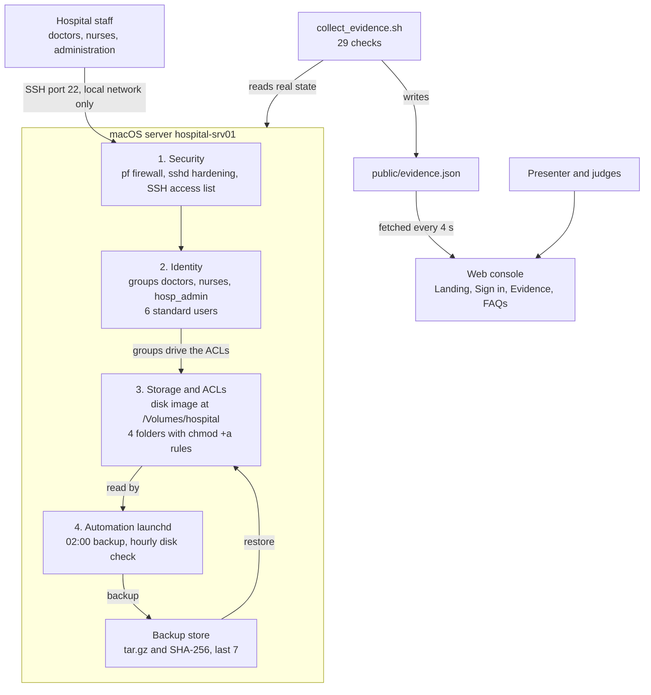
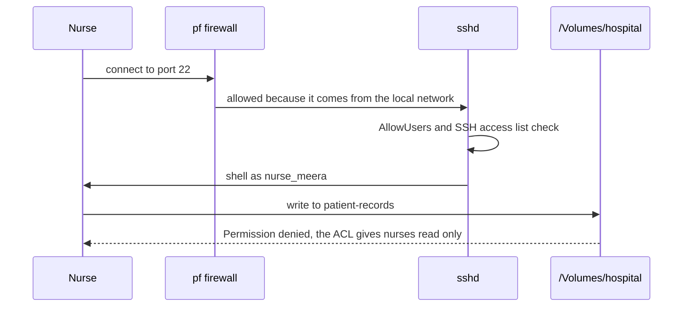

# Hospital IT Server Console

A hospital IT department needs one server for doctors, nurses and administration staff. Each group gets its own accounts and only the folder access its job needs, with scheduled backups, a firewall and hardened SSH. This repository holds the complete server build and a web console that shows the build with real terminal output as evidence.


### 📄 Project Documents

| Document | Link |
|----------|------|
| 📘 Project Report | [Project-Report.pdf](./hs-report.pdf) |
| 🎞️ Project Presentation (PDF) | [Project-Presentation.pdf](./hs-ppt.pdf) |
| 🎨 Project Presentation (Canva) | [View on Canva](https://canva.link/dn9qgcm42wbiu5z) |

---


## Contents

1. [At a glance](#at-a-glance)
2. [Architecture](#architecture)
3. [How it maps to the hackathon tasks](#how-it-maps-to-the-hackathon-tasks)
4. [Folder access](#folder-access)
5. [Repository layout](#repository-layout)
6. [Prerequisites](#prerequisites)
7. [Run the web console](#run-the-web-console)
8. [Server setup, stage by stage](#server-setup-stage-by-stage)
9. [Evidence page](#evidence-page)
10. [Presentation guide](#presentation-guide)
11. [Troubleshooting](#troubleshooting)
12. [Undo everything](#undo-everything-macos)
13. [Verification status and limits](#verification-status-and-limits)

## At a glance

| | |
|---|---|
| Scenario | Hospital IT department (problem statement 2) |
| Server | macOS, hostname `hospital-srv01` |
| Roles | doctors, nurses, administration (`hosp_admin`) |
| Sample users | `dr_asha`, `dr_ravi`, `nurse_meera`, `nurse_john`, `admin_priya`, `admin_kiran` |
| Storage | 2 GB sparse disk image mounted at `/Volumes/hospital` |
| Backups | daily at 02:00, SHA-256 checked, last 7 kept, restore script |
| Security | `pf` firewall, SSH hardening, permission audit |
| Console | Vite, React, TypeScript, Tailwind, with an Evidence page fed by the terminal |

## Architecture

The server holds four building blocks that depend on each other: security decides who can connect, identity decides who they are, storage decides what each group can touch, and automation protects the data. The console never runs commands. It only reads `public/evidence.json`, which `collect_evidence.sh` writes from the real state of the server.



What happens when a nurse tries to write a patient record:



| Component | Technology | Why |
|---|---|---|
| Accounts and groups | `dscl`, `dseditgroup` | Native macOS directory tools |
| Storage | Sparse disk image, APFS, ownership on | Separate volume that can be resized and unmounted, the macOS stand-in for LVM |
| Folder permissions | `chmod +a` ACLs | One folder, different rights per group |
| Scheduling | `launchd` | Native replacement for cron, runs missed jobs after sleep |
| Backup integrity | `tar`, `shasum` | A checksum is stored and checked after every backup |
| Firewall | `pf` with its own anchor | Blocks inbound traffic except SSH from the local network, rolls back if the network breaks |
| Remote access | `sshd_config.d` drop-in | Root off, three tries, named users, macOS SSH access list |
| Evidence | `collect_evidence.sh` to `evidence.json` | Real output for the console, because a web page cannot run commands |

## How it maps to the hackathon tasks

| Hackathon task | What was built | Where |
|---|---|---|
| 1. Linux system configuration | Hostname, network check, update check, packages | Stage 1 |
| 2. User and group administration | 3 groups, 6 users, passwords, private homes, ownership | Stage 2 |
| 3. Storage management | Disk image volume, mount, 4 shared folders | Stage 3 |
| 4. Automation | Backup, verify, restore and disk-check scripts scheduled with launchd | Stage 4 |
| 5. Backup and recovery | Dated archives, SHA-256 check, delete and restore demo | Stages 4 and 6 |
| 6. Security | Firewall, SSH hardening, permission and ACL audit | Stage 5 |
| 7. Testing and troubleshooting | Role tests, simulated storage failure and fix, Evidence page | Stage 6 and Evidence |

The scenario is built and tested on macOS. The Linux and Windows commands in each stage reproduce the same design on those systems.

## Folder access

| Folder | doctors | nurses | hosp_admin |
|---|---|---|---|
| patient-records | read and write | read | none |
| nursing-notes | read | read and write | none |
| billing | none | none | read and write |
| announcements | read | read | read and write |

The administration group is called `hosp_admin` because macOS already has a group named `admin` that grants full administrator rights. On Linux the commands use `admin`, and on Windows `hosp_admin`.

## Repository layout

```
README.md                         this file
docs/architecture.svg             architecture diagram, vector
docs/architecture.png             architecture diagram, for slides
linux/create_users.sh             Linux user and group script
public/architecture.svg           diagram shown on the Evidence page
public/evidence.json              real terminal output, written by collect_evidence.sh
src/App.tsx                       routes
src/auth.tsx                      browser-only sign in
src/data.ts                       stages, roles, folders, FAQs
src/evidence.ts                   loads evidence.json
src/pages/                        Landing, Auth, Evidence, FAQ
src/components/                   Layout, Protected, ui/hero.tsx
src/scripts/mac/create_users.sh        Stage 2: groups and users
src/scripts/mac/remove_users.sh        Stage 2: undo
src/scripts/mac/setup_storage.sh       Stage 3: disk image, folders, ACLs
src/scripts/mac/teardown_storage.sh    Stage 3: undo
src/scripts/mac/install_automation.sh  Stage 4: installs and schedules the jobs
src/scripts/mac/hospital_backup.sh     Stage 4: backup
src/scripts/mac/hospital_verify.sh     Stage 4: integrity check
src/scripts/mac/hospital_disk_check.sh Stage 4: 80% warning
src/scripts/mac/uninstall_automation.sh Stage 4: undo
src/scripts/mac/firewall.sh            Stage 5: pf firewall
src/scripts/mac/harden_ssh.sh          Stage 5: SSH hardening
src/scripts/mac/permission_audit.sh    Stage 5: audit
src/scripts/mac/hospital_restore.sh    Stage 6: restore
src/scripts/mac/role_tests.sh          Stage 6: role matrix test
src/scripts/mac/collect_evidence.sh    Evidence: 29 checks to evidence.json
```

## Prerequisites

| | macOS (tested) | Linux | Windows |
|---|---|---|---|
| System | macOS on Apple Silicon or Intel, an administrator account | Ubuntu 22.04 or 24.04 with sudo | Windows 10 or 11 Pro, PowerShell as Administrator |
| Tools | Homebrew, Node.js 20 or newer | `apt`, Node.js 20 or newer for the console | Node.js 20 or newer for the console |
| Free space | about 3 GB | about 3 GB | about 3 GB |

## Run the web console

```
cd ~/Desktop/hospital-it
```

```
npm install
```

```
npm run dev
```

Open http://localhost:5173. Console accounts are stored in your own browser only.

## Server setup, stage by stage

Run each block one at a time and check the result before moving on.

### Stage 1: base setup

**macOS**

```
mkdir -p ~/hospital-setup
```

```
scutil --get LocalHostName > ~/hospital-setup/original_localhostname.txt
```

```
sudo scutil --set HostName hospital-srv01
```

```
sudo scutil --set LocalHostName hospital-srv01
```

```
networksetup -getinfo Wi-Fi
```

```
softwareupdate -l
```

```
brew install rsync
```

**Linux (Ubuntu)**

```
sudo hostnamectl set-hostname hospital-srv01
```

```
ip -br addr
```

```
sudo apt update
```

```
sudo apt upgrade -y
```

```
sudo apt install -y acl lvm2 openssh-server ufw rsync
```

**Windows (PowerShell as Administrator)**

```
Rename-Computer -NewName hospital-srv01 -Force
```

```
Get-NetIPConfiguration
```

```
Add-WindowsCapability -Online -Name OpenSSH.Server~~~~0.0.1.0
```

Restart Windows to apply the new name. Install Windows updates from Settings, Windows Update.

### Stage 2: users and groups

**macOS**

```
sudo bash src/scripts/mac/create_users.sh
```

The script asks for one shared password for the six sample users and creates them as standard, hidden accounts with private home folders. Check the result:

```
dscl . -read /Groups/doctors GroupMembership
```

```
id nurse_meera
```

```
dseditgroup -o checkmember -m nurse_meera admin
```

**Linux (Ubuntu)**

```
sudo bash linux/create_users.sh
```

```
getent group doctors nurses admin
```

**Windows (PowerShell as Administrator)**

```
$pw = Read-Host -AsSecureString "Password for the sample users"
```

```
"doctors","nurses","hosp_admin" | ForEach-Object { New-LocalGroup -Name $_ }
```

```
$users = @{ dr_asha="doctors"; dr_ravi="doctors"; nurse_meera="nurses"; nurse_john="nurses"; admin_priya="hosp_admin"; admin_kiran="hosp_admin" }
```

```
$users.GetEnumerator() | ForEach-Object { New-LocalUser -Name $_.Key -Password $pw -AccountNeverExpires | Out-Null; Add-LocalGroupMember -Group $_.Value -Member $_.Key }
```

### Stage 3: storage and ACL folders

**macOS**

```
sudo bash src/scripts/mac/setup_storage.sh
```

This creates a 2 GB sparse disk image, mounts it at `/Volumes/hospital` with ownership enabled, creates the four folders and applies the ACLs. Check it:

```
ls -led /Volumes/hospital/*
```

```
sudo -u nurse_meera touch /Volumes/hospital/patient-records/test.txt
```

The nurse gets Permission denied. The disk image is unmounted after a restart, so run the same script again to remount it.

**Linux (Ubuntu)**

```
sudo truncate -s 2G /srv/hospital.img
```

```
LOOP=$(sudo losetup --find --show /srv/hospital.img)
```

```
sudo pvcreate "$LOOP"
```

```
sudo vgcreate hospital_vg "$LOOP"
```

```
sudo lvcreate -n data -l 100%FREE hospital_vg
```

```
sudo mkfs.ext4 /dev/hospital_vg/data
```

```
sudo mkdir -p /hospital
```

```
sudo mount /dev/hospital_vg/data /hospital
```

```
sudo mkdir -p /hospital/patient-records /hospital/nursing-notes /hospital/billing /hospital/announcements
```

```
sudo chmod 700 /hospital/patient-records /hospital/nursing-notes /hospital/billing /hospital/announcements
```

Apply the ACLs (the `-d` entries are defaults for new files):

```
sudo setfacl -m g:doctors:rwx,g:nurses:r-x /hospital/patient-records
```

```
sudo setfacl -d -m g:doctors:rwx,g:nurses:r-x /hospital/patient-records
```

```
sudo setfacl -m g:doctors:r-x,g:nurses:rwx /hospital/nursing-notes
```

```
sudo setfacl -d -m g:doctors:r-x,g:nurses:rwx /hospital/nursing-notes
```

```
sudo setfacl -m g:admin:rwx /hospital/billing
```

```
sudo setfacl -d -m g:admin:rwx /hospital/billing
```

```
sudo setfacl -m g:doctors:r-x,g:nurses:r-x,g:admin:rwx /hospital/announcements
```

```
sudo setfacl -d -m g:doctors:r-x,g:nurses:r-x,g:admin:rwx /hospital/announcements
```

```
getfacl /hospital/patient-records
```

To extend the volume later, grow the image file and run `sudo lvextend -r -L +1G /dev/hospital_vg/data`. A loop-backed volume must be attached again after a reboot (`losetup`, `vgchange -ay`, `mount`).

**Windows (PowerShell as Administrator)**

```
New-Item -ItemType Directory -Path C:\hospital-storage -Force
```

```
@"
create vdisk file=C:\hospital-storage\hospital.vhdx maximum=2048 type=expandable
select vdisk file=C:\hospital-storage\hospital.vhdx
attach vdisk
create partition primary
format fs=ntfs label=hospital quick
assign letter=H
"@ | Set-Content C:\hospital-storage\make.txt
```

```
diskpart /s C:\hospital-storage\make.txt
```

```
New-Item -ItemType Directory -Path H:\patient-records,H:\nursing-notes,H:\billing,H:\announcements
```

```
icacls H:\patient-records /inheritance:r /grant "Administrators:(OI)(CI)F" "SYSTEM:(OI)(CI)F" "doctors:(OI)(CI)M" "nurses:(OI)(CI)RX"
```

```
icacls H:\nursing-notes /inheritance:r /grant "Administrators:(OI)(CI)F" "SYSTEM:(OI)(CI)F" "doctors:(OI)(CI)RX" "nurses:(OI)(CI)M"
```

```
icacls H:\billing /inheritance:r /grant "Administrators:(OI)(CI)F" "SYSTEM:(OI)(CI)F" "hosp_admin:(OI)(CI)M"
```

```
icacls H:\announcements /inheritance:r /grant "Administrators:(OI)(CI)F" "SYSTEM:(OI)(CI)F" "doctors:(OI)(CI)RX" "nurses:(OI)(CI)RX" "hosp_admin:(OI)(CI)M"
```

### Stage 4: automation and backup

**macOS**

```
sudo bash src/scripts/mac/install_automation.sh
```

This installs the scripts to `/usr/local/hospital/bin` and schedules two `launchd` jobs: the backup every day at 02:00 and the disk check every hour. Backups go to `/Users/Shared/hospital-backups`, outside the disk image, and the last seven are kept.

```
sudo launchctl kickstart -k system/com.hospital.backup
```

```
sudo cat /var/log/hospital-backup.log
```

```
sudo /usr/local/hospital/bin/hospital_verify.sh
```

```
sudo /usr/local/hospital/bin/hospital_disk_check.sh 1
```

**Linux (Ubuntu)**

```
sudo tee /usr/local/bin/hospital_backup.sh > /dev/null << 'EOF'
#!/bin/bash
set -eu
DEST=/var/backups/hospital
mkdir -p "$DEST"
NAME="hospital-data-$(date +%Y%m%d-%H%M%S).tar.gz"
tar --acls -czf "$DEST/$NAME" -C /hospital patient-records nursing-notes billing announcements
(cd "$DEST" && sha256sum "$NAME" > "$NAME.sha256" && sha256sum -c "$NAME.sha256")
ls -1t "$DEST"/hospital-data-*.tar.gz | tail -n +8 | while read -r old; do rm -f "$old" "$old.sha256"; done
EOF
```

```
sudo tee /usr/local/bin/hospital_disk_check.sh > /dev/null << 'EOF'
#!/bin/bash
USED=$(df --output=pcent /hospital | tail -n 1 | tr -dc '0-9')
if [ "$USED" -ge "${1:-80}" ]; then
  echo "$(date '+%F %T') WARNING: /hospital is ${USED}% full" | tee -a /var/log/hospital-disk.log
fi
EOF
```

```
sudo chmod +x /usr/local/bin/hospital_backup.sh /usr/local/bin/hospital_disk_check.sh
```

```
sudo tee /etc/cron.d/hospital > /dev/null << 'EOF'
0 2 * * * root /usr/local/bin/hospital_backup.sh
0 * * * * root /usr/local/bin/hospital_disk_check.sh
EOF
```

```
sudo /usr/local/bin/hospital_backup.sh
```

**Windows (PowerShell as Administrator)**

```
@'
$dest = "C:\hospital-backups"
New-Item -ItemType Directory -Path $dest -Force | Out-Null
$name = "hospital-data-$(Get-Date -Format yyyyMMdd-HHmmss).zip"
Compress-Archive -Path H:\patient-records,H:\nursing-notes,H:\billing,H:\announcements -DestinationPath "$dest\$name"
(Get-FileHash "$dest\$name" -Algorithm SHA256).Hash | Set-Content "$dest\$name.sha256"
'@ | Set-Content C:\hospital-storage\backup.ps1
```

```
$action = New-ScheduledTaskAction -Execute "powershell.exe" -Argument "-NoProfile -File C:\hospital-storage\backup.ps1"
```

```
$trigger = New-ScheduledTaskTrigger -Daily -At 2am
```

```
Register-ScheduledTask -TaskName "HospitalBackup" -Action $action -Trigger $trigger -User "SYSTEM" -RunLevel Highest
```

```
Start-ScheduledTask -TaskName "HospitalBackup"
```

### Stage 5: security

**macOS**

```
sudo bash src/scripts/mac/firewall.sh check
```

```
sudo bash src/scripts/mac/firewall.sh on
```

```
sudo systemsetup -setremotelogin on
```

```
sudo bash src/scripts/mac/harden_ssh.sh apply
```

```
sudo bash src/scripts/mac/permission_audit.sh
```

The firewall allows SSH only from your local network and rolls itself back if the network check fails. `harden_ssh.sh` turns off root login, limits password tries, restricts logins to the named users and adds them to the macOS SSH access group. The audit checks every folder, ACL and setting and prints PASS or FAIL.

**Linux (Ubuntu)**

```
sudo ufw default deny incoming
```

```
sudo ufw default allow outgoing
```

```
sudo ufw allow from 192.168.0.0/24 to any port 22 proto tcp
```

```
sudo ufw enable
```

Replace `ubuntu` below with your own login name and the subnet above with your network:

```
sudo tee /etc/ssh/sshd_config.d/100-hospital.conf > /dev/null << 'EOF'
PermitRootLogin no
PermitEmptyPasswords no
MaxAuthTries 3
LoginGraceTime 60
X11Forwarding no
ClientAliveInterval 300
ClientAliveCountMax 2
AllowUsers ubuntu dr_asha dr_ravi nurse_meera nurse_john admin_priya admin_kiran
EOF
```

```
sudo sshd -t
```

```
sudo systemctl reload ssh
```

**Windows (PowerShell as Administrator)**

```
Set-NetFirewallProfile -Profile Domain,Public,Private -Enabled True -DefaultInboundAction Block
```

```
New-NetFirewallRule -DisplayName "Hospital SSH" -Direction Inbound -Protocol TCP -LocalPort 22 -RemoteAddress LocalSubnet -Action Allow
```

```
Start-Service sshd
```

```
Set-Service -Name sshd -StartupType Automatic
```

Windows has no root account, so the settings below block the built-in Administrator and allow named users. They must go at the top of the file, before the `Match` block:

```
$cfg = "C:\ProgramData\ssh\sshd_config"
$new = "MaxAuthTries 3`r`nLoginGraceTime 60`r`nDenyUsers Administrator`r`nAllowUsers dr_asha dr_ravi nurse_meera nurse_john admin_priya admin_kiran`r`n"
Set-Content $cfg ($new + (Get-Content $cfg -Raw))
```

```
Restart-Service sshd
```

### Stage 6: testing, recovery and demo

**macOS**

```
sudo bash src/scripts/mac/role_tests.sh
```

```
sudo launchctl kickstart -k system/com.hospital.backup
```

```
sudo rm -rf /Volumes/hospital/patient-records
```

```
sudo bash src/scripts/mac/hospital_restore.sh
```

```
sudo bash src/scripts/mac/role_tests.sh
```

**Linux (Ubuntu)**

```
sudo -u nurse_meera touch /hospital/patient-records/test.txt
```

```
sudo /usr/local/bin/hospital_backup.sh
```

```
sudo rm -rf /hospital/patient-records
```

```
sudo tar --acls -xzf "$(ls -1t /var/backups/hospital/hospital-data-*.tar.gz | head -n 1)" -C /hospital
```

```
getfacl /hospital/patient-records
```

**Windows (PowerShell as Administrator)**

```
Remove-Item H:\patient-records -Recurse -Force
```

```
$zip = Get-ChildItem C:\hospital-backups\hospital-data-*.zip | Sort-Object LastWriteTime | Select-Object -Last 1
```

```
Expand-Archive -Path $zip.FullName -DestinationPath H:\ -Force
```

```
icacls H:\patient-records /inheritance:r /grant "Administrators:(OI)(CI)F" "SYSTEM:(OI)(CI)F" "doctors:(OI)(CI)M" "nurses:(OI)(CI)RX"
```

To test a role on Windows, run `runas /user:nurse_meera cmd` and try to write into `H:\patient-records`.

## Evidence page

The console shows real terminal output. `collect_evidence.sh` runs 29 read-only checks on the Mac, one or more per stage. Each check records the command, its real output, the exit code and a PASS or FAIL result in `public/evidence.json`. The Evidence page reads that file and refreshes by itself every few seconds, and shows a PASS or FAIL badge for every stage.

```
sudo bash src/scripts/mac/collect_evidence.sh
```

Run it again at any time to refresh. A web page cannot run commands itself, so this script is how terminal output reaches the site. The file holds your local IP address and username, so check it before you share it.


## Presentation guide

A run of about 12 minutes. Use two Terminal tabs, one for commands and one for `npm run dev`, and make the terminal font large.

### 30 minutes before

Run each command once and fix anything that fails. The last command opens the console.

```
cd ~/Desktop/hospital-it
```

```
sudo -v
```

```
sudo bash src/scripts/mac/setup_storage.sh
```

```
sudo bash src/scripts/mac/firewall.sh on
```

```
sudo systemsetup -setremotelogin on
```

```
sudo bash src/scripts/mac/harden_ssh.sh apply
```

```
sudo launchctl list | grep hospital
```

Start the console in the second tab:

```
cd ~/Desktop/hospital-it
```

```
npm run dev
```

Back in the first tab, capture the evidence and open the site:

```
sudo bash src/scripts/mac/collect_evidence.sh
```

```
open http://localhost:5173
```

Every line should say PASS. If one says FAIL, open its card on the Evidence page and use the Troubleshooting table below.

Optional: show the server name in your prompt, and revert it afterward (see Undo):

```
sudo scutil --set HostName hospital-srv01
```

```
sudo scutil --set LocalHostName hospital-srv01
```

### Running order

| # | Minutes | Say | Run | Expect |
|---|---|---|---|---|
| 1 | 1 | "One server, three roles, four building blocks." | Show `docs/architecture.png` with `open docs/architecture.png` | The architecture diagram |
| 2 | 1 | "Who gets what is a matrix, and the ACLs are generated from it." | Show the Folder access table in this README | The table: nurses read patient records, administration has none |
| 3 | 1 | "Three groups and six standard users. None of them is an administrator." | `id nurse_meera` then `dseditgroup -o checkmember -m nurse_meera admin` | `nurses` in the group list, then `no` |
| 4 | 1 | "Storage is its own volume with ownership switched on, and each folder has ACL rules." | `ls -led /Volumes/hospital/patient-records` | Two ACL lines, nurses read and doctors read and write |
| 5 | 2 | "Now the real thing, as each role." | The four commands below | Denied, allowed, read back, denied |
| 6 | 1 | "All six users against all four folders." | `sudo bash src/scripts/mac/role_tests.sh` | A table with ok in every cell |
| 7 | 1 | "Backups are scheduled, but I can trigger one and verify it." | The three commands below | Backup created and verified, checksum OK |
| 8 | 2 | "Disaster: I delete the patient records on purpose." | The restore commands below | Folder gone, then restored with permissions |
| 9 | 1 | "The disk check warns at 80%. I lower the limit to show it." | `sudo /usr/local/hospital/bin/hospital_disk_check.sh 1` | Two WARNING lines |
| 10 | 1 | "Security: firewall, root over SSH, and the audit." | The security commands below | Rules shown, root denied, All checks passed |
| 11 | 1 | "Everything I just showed is recorded here, with real output." | Open the Evidence page | Every stage with a PASS badge |

Step 5, the live permissions:

```
sudo -u nurse_meera touch /Volumes/hospital/patient-records/test.txt
```

```
echo 'Patient 002 admitted' | sudo -u dr_asha tee /Volumes/hospital/patient-records/patient002.txt
```

```
sudo -u nurse_meera cat /Volumes/hospital/patient-records/patient002.txt
```

```
sudo -u admin_priya ls /Volumes/hospital/patient-records
```

Step 7, backup and verify:

```
sudo launchctl kickstart -k system/com.hospital.backup
```

```
sudo tail -n 2 /var/log/hospital-backup.log
```

```
sudo /usr/local/hospital/bin/hospital_verify.sh
```

Step 8, delete and restore:

```
sudo rm -rf /Volumes/hospital/patient-records
```

```
sudo ls /Volumes/hospital
```

```
sudo bash src/scripts/mac/hospital_restore.sh
```

```
sudo ls -led /Volumes/hospital/patient-records
```

```
sudo -u nurse_meera cat /Volumes/hospital/patient-records/patient002.txt
```

Optional extra, a simulated storage failure and its fix:

```
sudo hdiutil detach /Volumes/hospital
```

```
sudo /usr/local/hospital/bin/hospital_disk_check.sh
```

```
sudo bash src/scripts/mac/setup_storage.sh
```

Step 10, security:

```
sudo bash src/scripts/mac/firewall.sh status
```

```
ssh -o PubkeyAuthentication=no -o NumberOfPasswordPrompts=1 root@localhost
```

```
sudo bash src/scripts/mac/permission_audit.sh
```

### Likely questions

| Question | Answer |
|---|---|
| Why macOS and not Linux? | The build was done on a Mac, so every Linux task uses its macOS equivalent. The README has the Linux and Windows commands for each stage. |
| What replaces LVM? | A sparse disk image mounted as its own volume. It can be resized and unmounted, and ownership is on so permissions apply. |
| Why is the group `hosp_admin` and not `admin`? | macOS already has an `admin` group with full administrator rights. Reusing it would make hospital staff administrators of the whole machine. |
| How do you know a backup is good? | A SHA-256 checksum is stored with each archive and checked immediately, and the restore script checks it again before it restores anything. |
| Why launchd and not cron? | launchd is the native scheduler on macOS and runs a missed job when the Mac wakes. |
| What if the disk fills up? | An hourly check warns at 80%, the volume can be resized, and the backup store keeps only the last 7 archives. |
| How would this scale to a real hospital? | The user script is a loop over a list, so more users are more lines. A real deployment would use a central directory service such as LDAP, and the same ACL design carries over. |
| How safe is SSH here? | Root is off, there are three tries and a 60 second login window, only named users are allowed, and the firewall accepts SSH only from the local network. The sample password is weak on purpose for a demo, so the guide tells you to turn Remote Login off afterward. |
| What went wrong along the way? | macOS keeps its own SSH access list that blocked standard users, and the first status check missed the setting because of upper and lower case. Both were found through the logs and fixed in the scripts. |

## Troubleshooting

| Symptom | Cause | Fix |
|---|---|---|
| `/Volumes/hospital` is missing or storage checks fail | The disk image is unmounted after a restart | `sudo bash src/scripts/mac/setup_storage.sh` |
| Internet stops after the firewall step | pf rules blocked something | `sudo bash src/scripts/mac/firewall.sh off` |
| Firewall status shows Disabled | pf rules are cleared by a restart | `sudo bash src/scripts/mac/firewall.sh on` |
| SSH login closes right after the password | The user is not on the macOS SSH access list, or the password was mistyped | `sudo bash src/scripts/mac/harden_ssh.sh apply` and type the password promptly |
| Evidence page shows no evidence | The collector has not been run | `sudo bash src/scripts/mac/collect_evidence.sh` |
| Evidence shows FAIL for the restore log | No restore has been run yet | Run the Step 8 restore once |
| `npm run dev` says the port is busy | An old dev server is still running | Close the other tab or run `lsof -i :5173` and stop that process |
| `systemsetup` refuses to change Remote Login | Terminal lacks Full Disk Access | Turn on Remote Login in System Settings, General, Sharing |
| Prompt still shows `hospital-srv01` | The shell started before the hostname changed | Open a new Terminal tab |

## Undo everything (macOS)

```
sudo bash src/scripts/mac/uninstall_automation.sh
```

```
sudo bash src/scripts/mac/firewall.sh off
```

```
sudo bash src/scripts/mac/harden_ssh.sh remove
```

```
sudo systemsetup -setremotelogin off
```

```
sudo bash src/scripts/mac/teardown_storage.sh
```

```
sudo bash src/scripts/mac/remove_users.sh
```

```
sudo rm -rf /Users/Shared/hospital-backups
```

The hostname change is saved in `~/hospital-setup/original_localhostname.txt`. To restore it:

```
sudo scutil --set HostName "$(cat ~/hospital-setup/original_localhostname.txt)"
```

```
sudo scutil --set LocalHostName "$(cat ~/hospital-setup/original_localhostname.txt)"
```


## Verification status and limits

| Item | Status |
|---|---|
| macOS Stages 1 to 6 | Run on a real Mac, results checked stage by stage |
| `collect_evidence.sh` and the Evidence page | The JSON writer and the pass or fail logic were tested with sample checks. Run it on your Mac to produce the real evidence. |
| Linux commands | `linux/create_users.sh` was run, and the backup and disk-check scripts were tested on Linux. The rest are standard commands that were not run in this project. |
| Windows commands | Provided as equivalents and not run in this project |

Known limits:

- The disk image is unmounted after a restart. Run `setup_storage.sh` to mount it again.
- `pf` rules are cleared by a restart. Run `firewall.sh on` again.
- The sample users share one password. Use a strong one on a shared network.
- Turning on Remote Login makes SSH reachable from the local network. Run the undo steps when you are finished.
- Restored files get their ACLs from the folder. Per-file ACLs set by hand are not restored.

## Security note

This is a demo build. The sample users share one password, and SSH is reachable from the local network while Remote Login is on. Use a strong password if the machine is on a shared network, and run the undo steps when you are finished.
